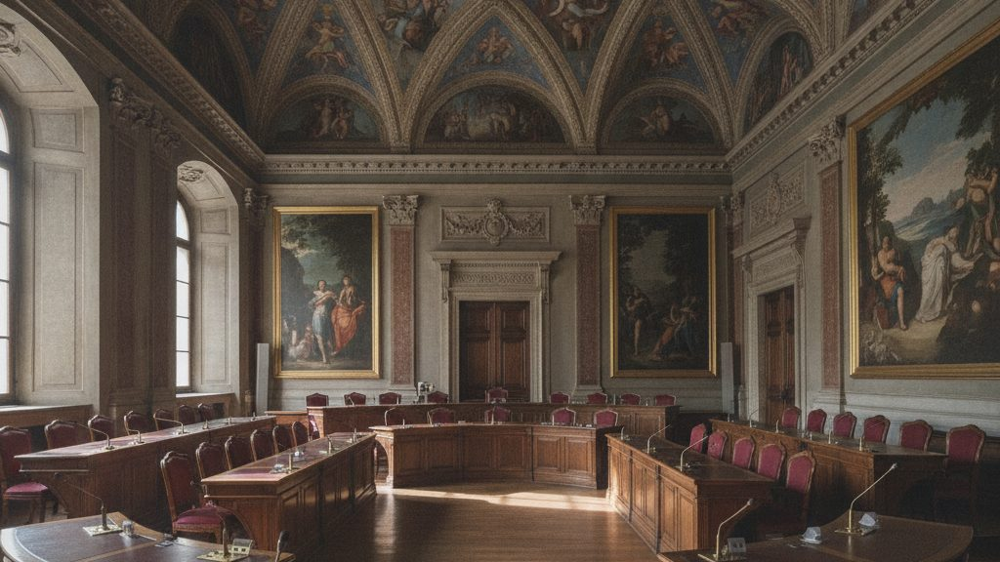

Il Consiglio comunale, riunito lunedì 12 gennaio, ha approvato il bilancio di previsione 2026 con 11 voti favorevoli e 5 contrari. Tributi e tariffe dei servizi restano invariati.

{.rounded fig-alt="Sala del Consiglio comunale con banchi in legno a semicerchio e soffitto affrescato"}

## Dove vanno le risorse

| Voce | Milioni di euro |
|------|----------------:|
| Scuole e servizi educativi | 3,2 |
| Strade e manutenzioni | 2,4 |
| Servizi sociali | 2,1 |
| Cultura e sport | 0,8 |

: Principali voci di spesa

Il testo completo e gli allegati sono consultabili nella sezione [Amministrazione](../amministrazione.qmd).
