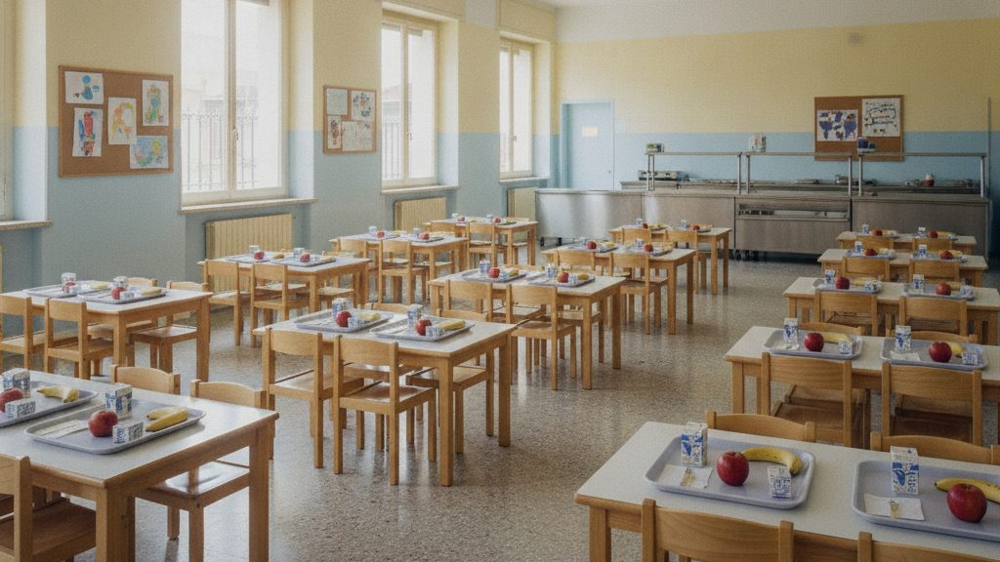

Sono aperte le iscrizioni al servizio di mensa per l'anno scolastico 2026/2027. La domanda va presentata entro il 15 marzo, anche per chi usa già il servizio.

{.rounded fig-alt="Refettorio scolastico con piccoli tavoli apparecchiati con vassoi e frutta"}

## Cosa serve

1. accedere con SPID o CIE alla pagina dei [servizi](../servizi.qmd)
2. indicare scuola e classe di ogni bambino o bambina
3. allegare l'attestazione ISEE, se si chiede una tariffa ridotta

Le diete speciali per motivi di salute o religiosi si richiedono nello stesso modulo.
