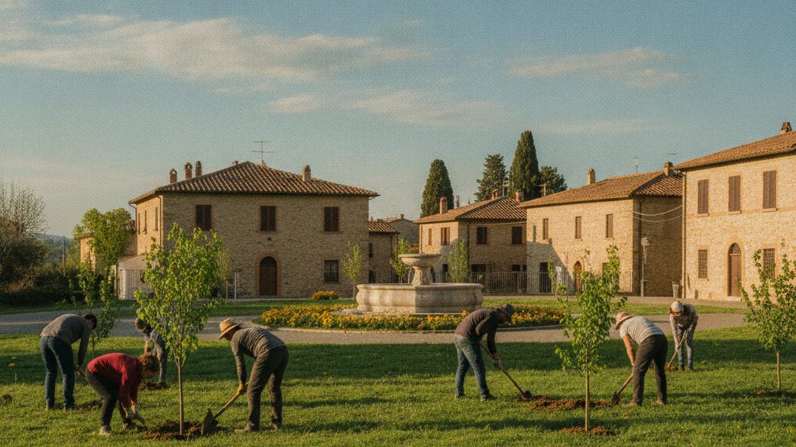

Sabato scorso duecento volontari hanno messo a dimora cento alberi nel parco della Rimembranza. Sono tigli, aceri e carpini scelti con l'ufficio Ambiente tra le specie più adatte al clima della zona.

{.rounded fig-alt="Volontari che piantano giovani alberi su un prato, con le case del paese sullo sfondo"}

> Fra vent'anni questo viale sarà all'ombra, e a goderne saranno soprattutto i bambini che oggi hanno tenuto in mano la pala.
>
> [Una maestra della scuola primaria]{.blockquote-footer}

Il Comune curerà l'irrigazione per i primi tre anni. Chi vuole partecipare alle prossime giornate può scrivere all'ufficio Ambiente.
