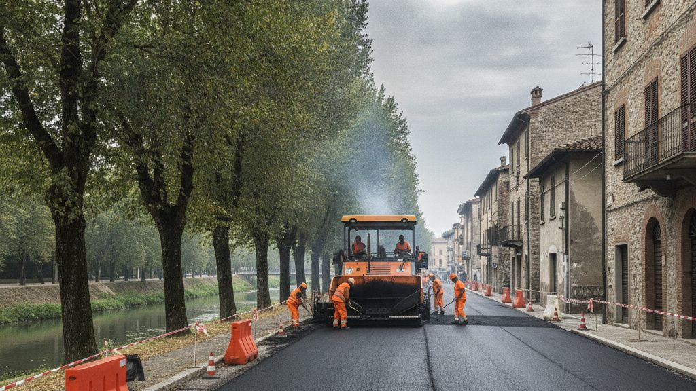

Da lunedì 9 marzo iniziano i lavori di rifacimento del manto stradale sul lungofiume, nel tratto compreso tra il ponte vecchio e il ponte della ferrovia. Il cantiere procede per tratti successivi e la conclusione è prevista per il 30 aprile.

{.rounded fig-alt="Macchina asfaltatrice al lavoro su una strada alberata lungo il fiume, tra barriere arancioni"}

## Le modifiche alla circolazione

- senso unico alternato regolato da semaforo, dalle 7.30 alle 18
- divieto di sosta su entrambi i lati nel tratto del cantiere
- fermata degli autobus spostata davanti al mercato coperto

I residenti possono ritirare il permesso di sosta temporaneo all'ufficio della Polizia locale.

::: {.callout-warning title="Attenzione"}
Le date possono cambiare in caso di maltempo. Gli aggiornamenti vengono pubblicati su questa pagina.
:::
