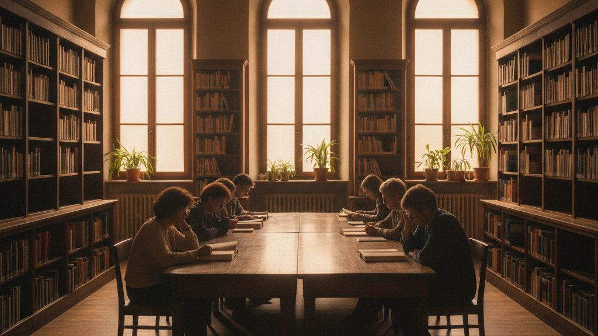

Da lunedì 16 marzo la biblioteca comunale torna aperta al pubblico. Il restauro, durato diciotto mesi, ha riguardato il consolidamento dei solai, gli impianti e l'accessibilità: l'ingresso principale è ora senza gradini e un ascensore collega i tre piani dell'edificio.

{.rounded fig-alt="Sala di lettura della biblioteca con scaffali in legno e persone sedute a un lungo tavolo"}

## Cosa cambia

La sala di lettura passa da 40 a 72 posti e al piano terra apre una sezione per bambini e ragazzi. Il fondo di storia locale, finora conservato in deposito, è consultabile a scaffale aperto.

> Una biblioteca è un luogo in cui si può stare senza dover comprare nulla. Abbiamo voluto che restasse così, con più spazio e più ore a disposizione di chi studia e di chi legge.
>
> [Assessora alla Cultura]{.blockquote-footer}

## Come accedere

L'iscrizione è gratuita e si fa al banco prestiti con un documento d'identità. Chi era già iscritto non deve fare nulla: la tessera resta valida.

::: {.callout-note title="Orari"}
Da lunedì a venerdì dalle 9 alle 19, il sabato dalle 9 alle 13.
:::
